Al terminar esta guía sabrás qué son Git y GitHub, tendrás todo instalado y habrás propuesto tu primer cambio a esta misma web. Todo se hace desde **Visual Studio Code**, el editor que usa casi todo el mundo para programar. No necesitas saber programar ni haberlo usado antes.

## Qué es Git

Git es un programa que guarda el **historial de cambios** de una carpeta. Cada vez que terminas algo, guardas un punto en ese historial, llamado **commit**, con un mensaje que explica qué cambiaste.

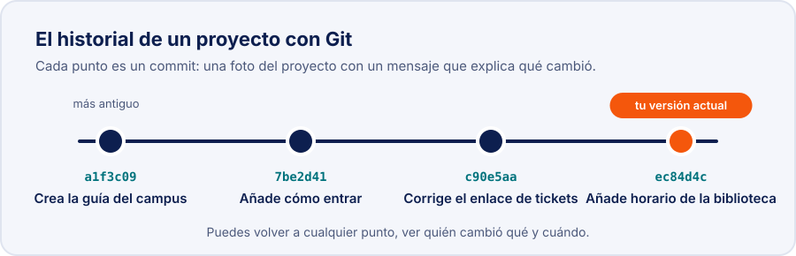

*Cada punto es un commit. El último es la versión actual del proyecto.*

¿Por qué es tan importante?

- **Puedes volver atrás.** Si algo se rompe, regresas a un commit anterior.
- **Sabes quién cambió qué y cuándo.** Cada commit tiene autor, fecha y mensaje.
- **Varias personas trabajan a la vez** sin pisarse el trabajo.
- **Se usa en casi todos los trabajos de software.** Saber Git es tan básico como saber usar un procesador de textos.

## Git no es GitHub

Se confunden mucho, pero son cosas distintas:

- **Git** es el programa que instalas en tu computadora. Funciona sin internet.
- **GitHub** es un sitio web que guarda una copia de tus proyectos de Git para compartirlos y colaborar. **GitLab** es una alternativa que funciona igual.

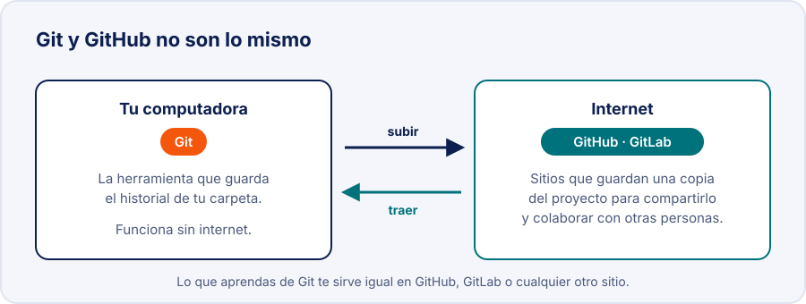

*Git trabaja en tu computadora; GitHub guarda la copia compartida.*

Esta web está en GitHub: [Sethprie/uneti-web](https://github.com/Sethprie/uneti-web).

## El camino de un cambio

Esta es la idea más importante de la guía. Un cambio pasa por cuatro lugares antes de llegar a GitHub:

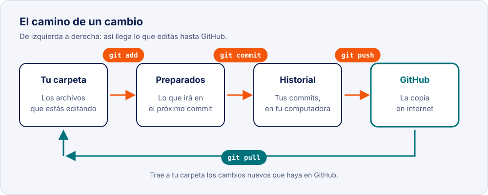

*En VS Code cada flecha es un botón. Debajo de cada paso verás también el comando equivalente.*

1. **Tu carpeta:** editas los archivos como siempre.
2. **Preparados:** eliges qué cambios entrarán en el próximo commit (`git add`).
3. **Historial:** guardas el punto, con su mensaje (`git commit`).
4. **GitHub:** subes tus commits a internet (`git push`).

Y al revés: `git pull` trae a tu carpeta lo que otras personas hayan subido.

## Lo que necesitas

### 1. Visual Studio Code

Entra en [code.visualstudio.com/download](https://code.visualstudio.com/download), descarga la versión para tu sistema e instálala con las opciones por defecto.

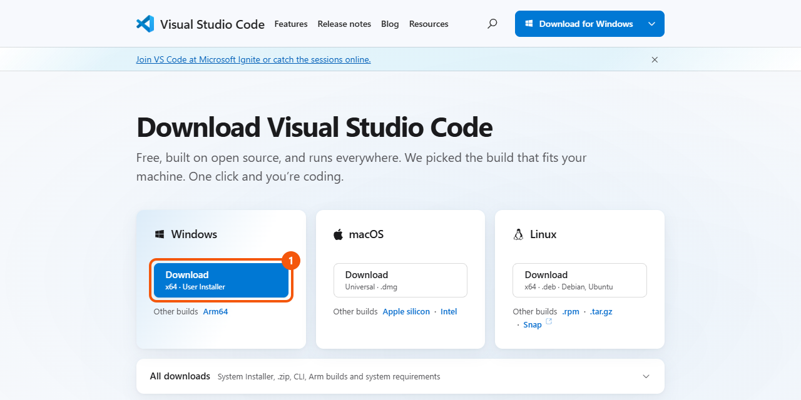

*Es gratuito. No lo confundas con «Visual Studio», que es otro programa.*

### 2. Git

Entra en [git-scm.com/install/windows](https://git-scm.com/install/windows) y pulsa **Click here to download**.

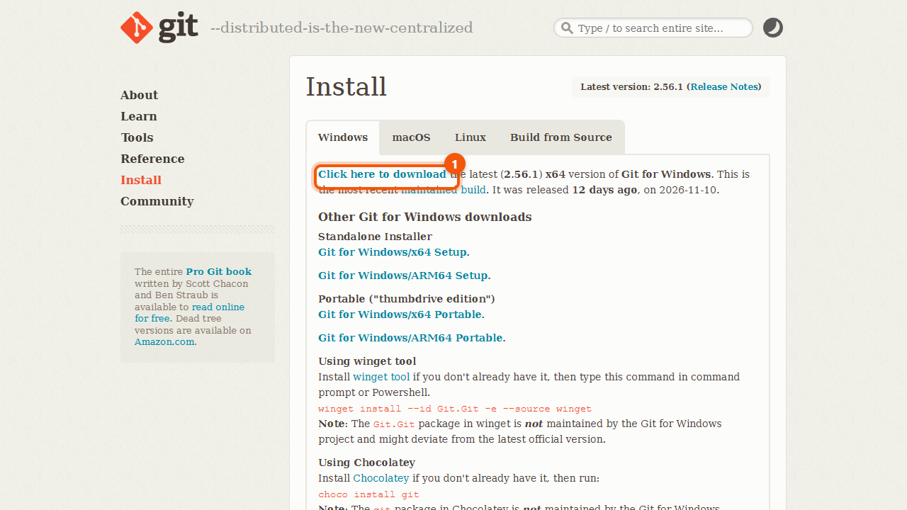

*La página detecta tu sistema y ofrece la versión adecuada.*

Abre el instalador. Casi todas las pantallas se dejan como vienen: pulsa **Next**. Fíjate en dos:

- **Choosing the default editor:** elige **Use Visual Studio Code as Git's default editor**. Por eso instalamos VS Code primero.
- **Choose a credential helper:** deja marcado **Git Credential Manager**. Es lo que guarda tu sesión de GitHub.

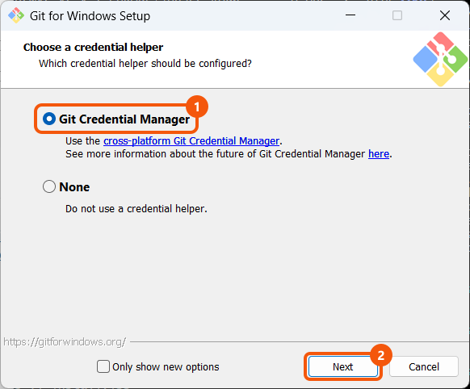

*Captura: proyecto [Git Credential Manager](https://github.com/git-ecosystem/git-credential-manager), licencia MIT.*

> **macOS y Linux:** en macOS, abre la Terminal y escribe `git --version`; si no está instalado, el sistema te ofrecerá instalarlo. En Linux, usa el gestor de paquetes, por ejemplo `sudo apt install git`.

### 3. Una cuenta de GitHub

1. Entra en [github.com/signup](https://github.com/signup) y regístrate. Elige un nombre de usuario que te sirva en el futuro: lo verán quienes revisen tu trabajo, incluidas empresas.


*Correo (1), contraseña (2) y usuario (3); luego, **Create account** (4). El registro es gratuito.*

2. Activa la **verificación en dos pasos** en **Settings → Password and authentication**. GitHub te la pedirá cuando empieces a subir código, y protege tu cuenta.

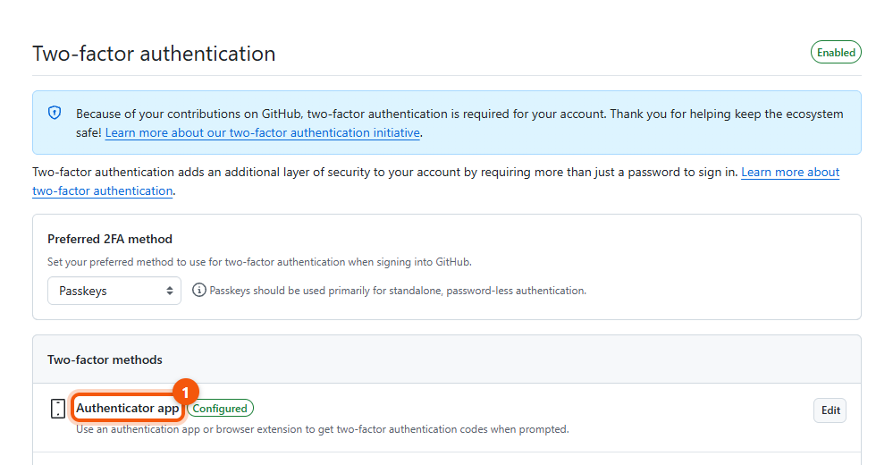

*Si aún no la tienes, verás el botón **Enable two-factor authentication**. Elige «Authenticator app» y usa una app como Google Authenticator o Authy. Así se ve cuando ya está activa.*

## Conoce VS Code

> **VS Code en español.** La primera vez que lo abras, VS Code puede ofrecerte instalar el paquete de idioma español. Te recomendamos dejarlo en inglés: las capturas de esta guía y casi toda la documentación están en inglés. Si ya lo tienes en español, estos son los nombres que verás:
>
> | En inglés | En español |
> | --- | --- |
> | Source Control | Control de código fuente |
> | Changes / Staged Changes | Cambios / Cambios almacenados provisionalmente |
> | Commit | Confirmar |
> | Publish Branch / Sync Changes | Publicar rama / Sincronizar cambios |
> | Create new branch... | Crear nueva rama... |
> | Clone Git Repository... | Clonar repositorio Git... |

Solo vas a usar cuatro partes de la ventana:

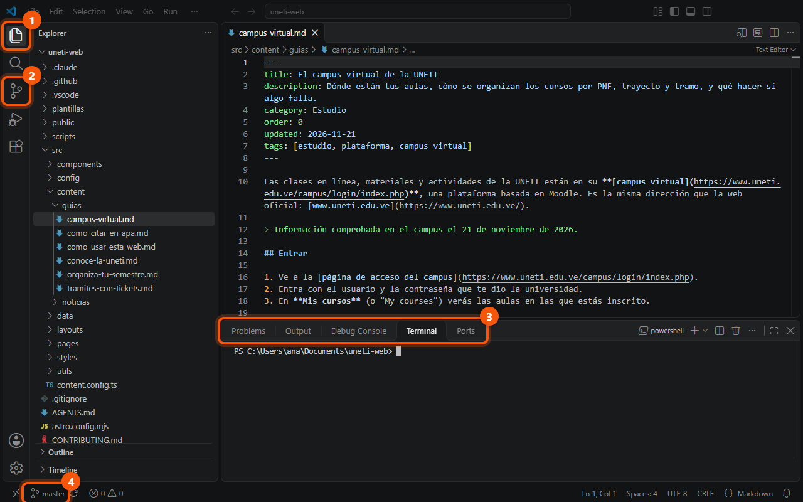

*Las cuatro partes que usarás en esta guía.*

1. **Explorador:** los archivos del proyecto. Haz clic en uno para abrirlo en el editor.
2. **Control de código fuente** (*Source Control*): el panel de Git. Aquí ves tus cambios y haces los commits.
3. **Terminal:** una ventana para darle órdenes a la computadora escribiendo. Se abre en **View → Terminal**, o con `Ctrl+ñ` en teclado español (`` Ctrl+` `` en inglés).
4. **Barra inferior:** muestra en qué rama estás. Haz clic ahí para cambiar de rama.

### Qué es la terminal

Normalmente usas la computadora con el ratón: haces clic en botones y menús. La **terminal** es otra forma de hacer lo mismo, pero **escribiendo**. Cada orden que escribes se llama **comando**, y se ejecuta al pulsar `Enter`.

- El texto que aparece antes del cursor, como `PS C:\Users\ana\Documents\uneti-web>`, es el **prompt**. Te dice en qué carpeta estás: los comandos actúan sobre esa carpeta.
- La de VS Code ya se abre en la carpeta del proyecto, así que no tienes que moverte a ningún sitio.
- En Windows, la terminal de VS Code usa **PowerShell**. No necesitas aprenderlo: solo vas a escribir comandos de Git, que empiezan por `git`.
- Si un comando falla, no se rompe nada. La terminal te muestra un mensaje y puedes volver a intentarlo.

En esta guía casi todo se hace con botones, pero la terminal es útil para comprobar qué está pasando y la usarás una vez para configurar Git.

### Configura tu nombre

Git pone tu nombre y correo en cada commit. Abre la terminal de VS Code y escribe estos comandos, uno por uno, pulsando `Enter` después de cada uno. Solo se hace una vez:

```sh
git --version
git config --global user.name "Tu Nombre"
git config --global user.email "tu-correo@ejemplo.com"
```

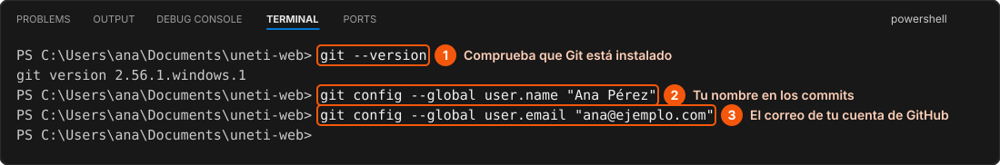

*Usa el mismo correo de tu cuenta de GitHub.*

> Git puede mostrarte sus mensajes en inglés o en español, según tu sistema. Las imágenes de esta guía están en inglés, que es lo más común.

## Los conceptos que vas a usar

### Repositorio

Un **repositorio** (o *repo*) es un proyecto guardado con Git: sus archivos más todo su historial. Esta web es un repositorio. **Clonar** es descargar un repositorio a tu computadora.

Cada repositorio de GitHub tiene una **dirección** (URL) para clonarlo. Por ejemplo, la de esta web es `https://github.com/Sethprie/uneti-web.git`:

- `Sethprie` es el usuario dueño del repositorio.
- `uneti-web` es el nombre del repositorio.
- `.git` al final indica que es la dirección para clonar.

Para obtenerla de cualquier repositorio: entra en su página de GitHub, pulsa el botón verde **Code**, deja seleccionada la pestaña **HTTPS** y pulsa el icono de copiar.


*El icono de los dos cuadrados, a la derecha de la dirección, la copia.*

### Ramas

Una **rama** es una línea de trabajo aparte. Creas una rama para tu cambio, trabajas en ella y, cuando está lista, se une a la principal. Así la versión publicada nunca se rompe mientras trabajas.

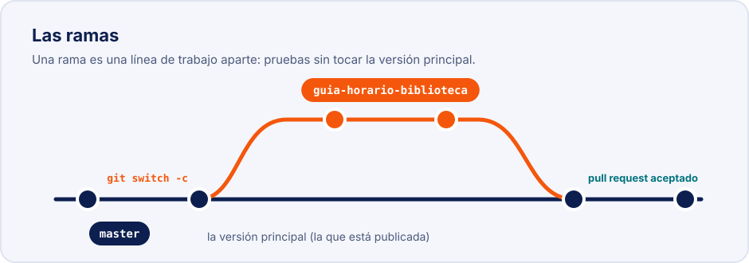

*En esta web la rama principal se llama `master`. En otros proyectos se llama `main`.*

### Fork

No puedes subir cambios directamente a un proyecto ajeno. Por eso se usa un **fork**: tu propia copia del repositorio en GitHub. Subes tus cambios a tu copia y desde ahí pides que pasen al original. VS Code crea el fork por ti la primera vez que publicas.


*Los tres pasos de cualquier contribución en GitHub.*

### Pull request

Un **pull request** (PR) es la propuesta que haces para que tus cambios entren en el proyecto original. Quien mantiene el proyecto lo revisa, puede pedirte ajustes y, si está bien, lo acepta.


*La confusión más común al empezar.*

## Práctica: tu primera contribución

Vas a proponer un cambio pequeño a una guía de esta web. En el ejemplo, añadimos un consejo al final de la guía del campus virtual; tú puedes corregir una errata o añadir un dato útil en la guía que prefieras. Todo desde VS Code.

### 1. Clona el repositorio

Abre VS Code. En la pantalla de bienvenida, pulsa **Clone Git Repository...**

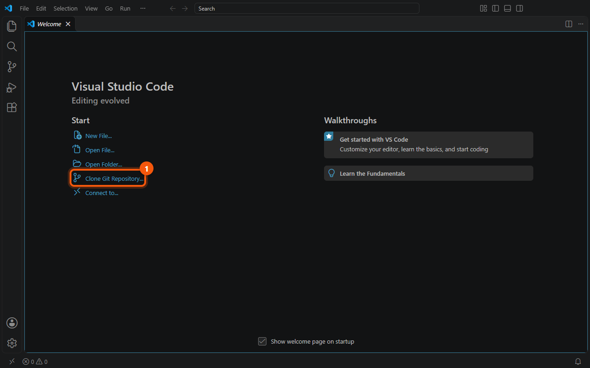

*Si no ves la bienvenida: **File → New Window**.*

Pega la dirección del repositorio de esta web y pulsa `Enter`. Es la que viste en [Repositorio](#repositorio), o puedes copiarla del botón **Code** de [su página en GitHub](https://github.com/Sethprie/uneti-web):

```text
https://github.com/Sethprie/uneti-web.git
```

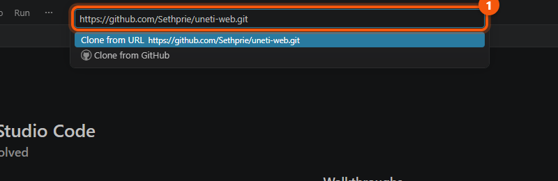

*Es la dirección del proyecto original, no hace falta crear nada antes.*

Elige la carpeta donde guardarlo (por ejemplo, Documentos) y, cuando termine, pulsa **Open**.

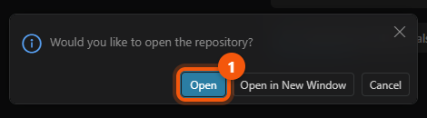

*VS Code abre la carpeta del proyecto.*

En la terminal: `git clone https://github.com/Sethprie/uneti-web.git`

### 2. Crea tu rama

Haz clic en **master**, en la barra inferior. En el menú, elige **Create new branch...**

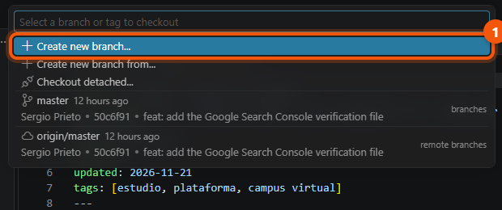

*También muestra las ramas que ya existen, para cambiar entre ellas.*

Escribe un nombre corto, en minúsculas y con guiones, y pulsa `Enter`:

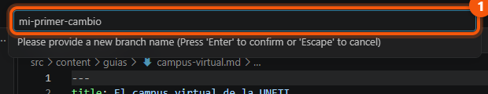

*Para tus próximos cambios, usa nombres que digan qué haces, como `corrige-enlace-campus`.*

La barra inferior ahora muestra tu rama. Todo lo que hagas desde aquí queda en ella.

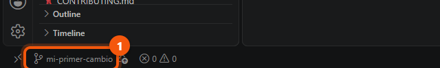

*Para volver a la principal, haz clic aquí y elige `master`.*

En la terminal: `git switch -c mi-primer-cambio`

> En tutoriales viejos verás `git checkout -b` en lugar de `git switch -c`. Hacen lo mismo; `switch` es la forma moderna.

### 3. Haz tu cambio

En el explorador, abre `src/content/guias/` y luego la guía que quieres mejorar. Las guías están escritas en **Markdown**, un formato de texto sencillo: `**negrita**`, `## Título`, `- lista` y `[texto](enlace)`.

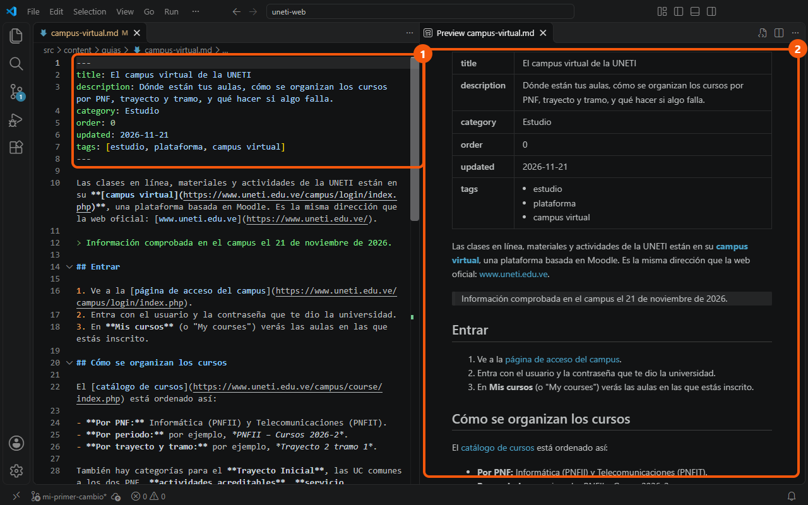

*Pulsa `Ctrl+K` y luego `V` para ver la vista previa al lado mientras escribes.*

1. **El encabezado** (entre las dos líneas `---`) son los datos de la guía. No lo toques, salvo para poner la fecha de hoy en `updated`.
2. **La vista previa** muestra cómo quedará el texto. Si algo se ve raro ahí, también se verá raro en la web.

Haz tu cambio debajo del encabezado y guarda con `Ctrl+S`. Para crear una guía nueva, sigue las [instrucciones para contribuir](https://github.com/Sethprie/uneti-web/blob/master/CONTRIBUTING.md).

Ve al panel de **Control de código fuente**. Tu archivo aparece en **Changes**, con una **M** de «modificado».

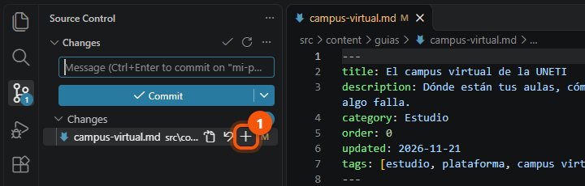

*Al pasar el ratón por el archivo aparece el botón **+**.*

Si haces clic en el archivo, VS Code te muestra el antes y el después, línea por línea.

En la terminal, `git status` te dice lo mismo:

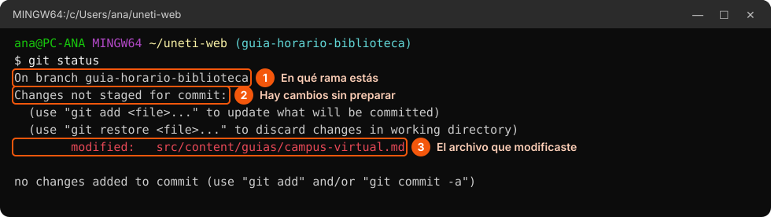

*`git status` es tu brújula: siempre te dice dónde estás y qué falta.*

### 4. Prepara y haz el commit

1. Pulsa el **+** junto al archivo. Pasa a **Staged Changes** (preparados).
2. Escribe en el cuadro de arriba un mensaje que explique el cambio.
3. Pulsa **Commit**.

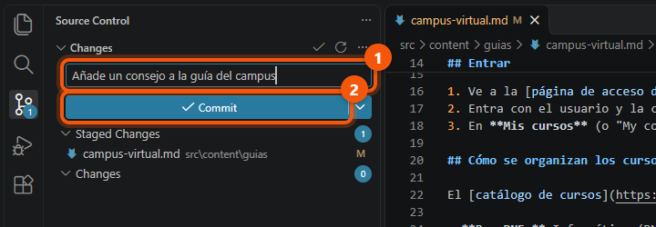

*Un buen mensaje dice qué cambia, en pocas palabras: «Añade un consejo a la guía del campus».*

En la terminal:

```sh
git add src/content/guias/campus-virtual.md
git commit -m "Añade un consejo a la guía del campus"
```

### 5. Publica tu rama

Pulsa **Publish Branch**.

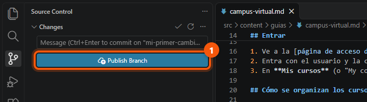

*Solo la primera vez se llama así; luego el botón sube los cambios nuevos.*

La primera vez, VS Code te pide iniciar sesión en GitHub. Pulsa **Allow**, autoriza en el navegador que se abre y vuelve a VS Code.

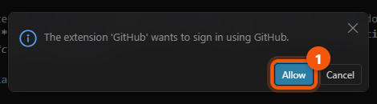

*Comprueba en el navegador que estás en tu cuenta antes de autorizar.*

Como no tienes permiso para subir al proyecto original, VS Code te ofrece crear tu fork. Pulsa **Create Fork**.

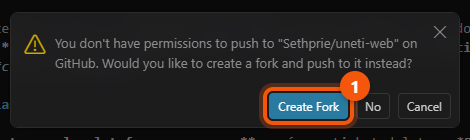

*Solo pasa la primera vez. Las siguientes, tu rama va directa a tu fork.*

En la terminal: `git push -u origin mi-primer-cambio`. Ojo: este comando **no crea el fork**. Úsalo solo cuando VS Code ya lo haya creado, o para subir cambios nuevos después.

### 6. Abre el pull request

Cuando el fork está listo, VS Code te avisa. Pulsa **Create PR**.

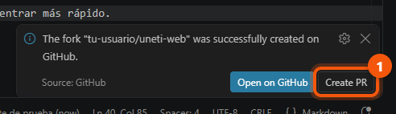

*Si cerraste el aviso, entra en tu fork en GitHub: verás una franja amarilla con el botón verde **Compare & pull request**.*

Se abre GitHub en el navegador. Revisa el título, explica en la descripción qué cambiaste y por qué, y pulsa **Create pull request**.

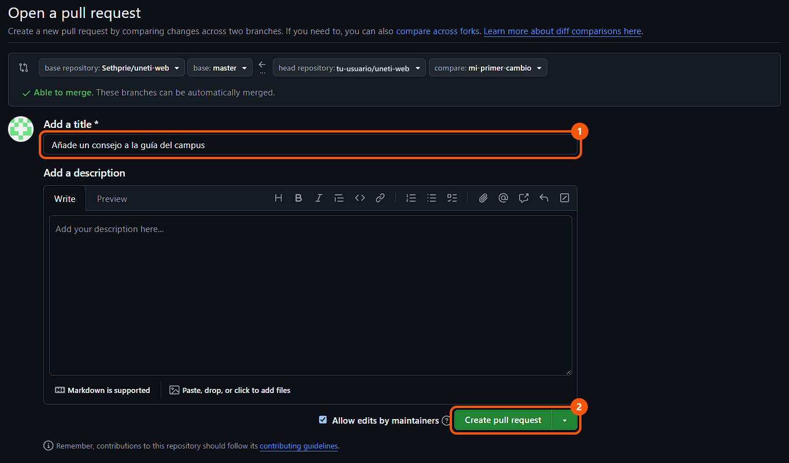

*Arriba se ve que propones los cambios de tu fork (`tu-usuario/uneti-web`) al original (`Sethprie/uneti-web`). El título se rellena con el mensaje de tu commit.*

## Después del pull request

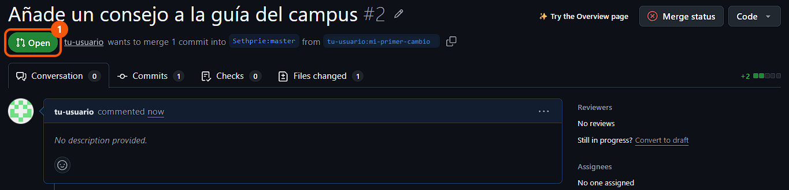

*«Open» significa que espera revisión. Recibirás un aviso por correo cuando alguien comente.*

- **Si te piden ajustes:** haz los cambios en la misma rama, commit y pulsa **Sync Changes** en el panel de Git. El pull request se actualiza solo.
- **Cuando lo aceptan:** tu cambio llega a `master` y se publica en la web.
- **Para tu siguiente contribución:** cambia a `master` en la barra inferior y trae lo último del proyecto original con `git pull upstream master` en la terminal. Luego crea una rama nueva.

> VS Code llama `origin` a tu fork y `upstream` al proyecto original. Por eso para traer lo nuevo del original se usa `upstream`.

## Si algo sale mal

- **No sabes dónde estás:** escribe `git status` en la terminal. Te dice la rama, qué cambió y, muchas veces, qué hacer.
- **El panel de Git no muestra tus cambios:** comprueba que guardaste el archivo (`Ctrl+S`) y que abriste la carpeta del proyecto, no un archivo suelto.
- **Hiciste cambios en `master` sin querer:** crea la rama ahora desde la barra inferior. Tus cambios se van contigo a la rama nueva.
- **Iniciaste sesión con otra cuenta:** en VS Code, haz clic en el icono de cuentas (abajo a la izquierda), cierra la sesión de GitHub y vuelve a publicar.

> **Para una errata rápida** también puedes editar el archivo directamente en GitHub con el botón del lápiz, sin instalar nada.

## Qué no cubre esta guía

Lo que viste es suficiente para contribuir. Cuando quieras avanzar, estos son los siguientes temas:

- **Conflictos:** cuando dos personas cambian la misma línea y Git no sabe con cuál quedarse. VS Code te ayuda a resolverlos.
- **`git stash`:** guardar cambios a medias sin hacer commit.
- **`git rebase`:** reordenar o limpiar el historial de una rama.
- **Ver la web en tu computadora:** con Node.js y pnpm, siguiendo el [README del proyecto](https://github.com/Sethprie/uneti-web#readme).
- **GitHub Actions:** tareas automáticas. Esta web las usa para publicarse.

### Para seguir aprendiendo

- **[Git en VS Code](https://code.visualstudio.com/docs/sourcecontrol/overview):** la documentación oficial del panel de Git.
- **[Pro Git](https://git-scm.com/book/es/v2):** el libro oficial de Git, gratuito y en español.
- **[Learn Git Branching](https://learngitbranching.js.org/?locale=es_ES):** ejercicios interactivos para entender las ramas, en español.
- **[GitHub Skills](https://skills.github.com/):** cursos prácticos dentro del propio GitHub.

¿Te trabaste en algún paso? Pregunta en la comunidad: los enlaces están en la [página de inicio](/#comunidad).
