Al terminar esta guía sabrás qué son Git y GitHub, tendrás todo instalado y habrás propuesto tu primer cambio a esta misma web. No necesitas saber programar.

> **Dos caminos.** Si solo quieres corregir un texto, la [ruta rápida](#ruta-rápida-desde-el-navegador) se hace desde el navegador, sin instalar nada. Si quieres aprender Git de verdad, sigue la guía completa.

## Qué es Git

Git es un programa que guarda el **historial de cambios** de una carpeta. Cada vez que terminas algo, guardas un punto en ese historial, llamado **commit**, con un mensaje que explica qué cambiaste.


*Cada punto es un commit. El último es la versión actual del proyecto.*

¿Por qué es tan importante?

- **Puedes volver atrás.** Si algo se rompe, regresas a un commit anterior.
- **Sabes quién cambió qué y cuándo.** Cada commit tiene autor, fecha y mensaje.
- **Varias personas trabajan a la vez** sin pisarse el trabajo.
- **Se usa en casi todos los trabajos de software.** Saber Git es tan básico como saber usar un procesador de textos.

## Git no es GitHub

Se confunden mucho, pero son cosas distintas:

- **Git** es el programa que instalas en tu computadora. Funciona sin internet.
- **GitHub** es un sitio web que guarda una copia de tus proyectos de Git para compartirlos y colaborar. **GitLab** es una alternativa que funciona igual.


*Git trabaja en tu computadora; GitHub guarda la copia compartida.*

Esta web está en GitHub: [Sethprie/uneti-web](https://github.com/Sethprie/uneti-web).

## El camino de un cambio

Esta es la idea más importante de la guía. Un cambio pasa por cuatro lugares antes de llegar a GitHub:


*Cada flecha es un comando. Los verás todos en la práctica.*

1. **Tu carpeta:** editas los archivos como siempre.
2. **Preparados:** con `git add` eliges qué cambios entrarán en el próximo commit.
3. **Historial:** con `git commit` guardas el punto, con su mensaje.
4. **GitHub:** con `git push` subes tus commits a internet.

Y al revés: `git pull` trae a tu carpeta lo que otras personas hayan subido.

## Instalar Git

### Windows

1. Entra en [git-scm.com/install/windows](https://git-scm.com/install/windows) y pulsa **Click here to download**.


*La página detecta tu sistema y ofrece la versión adecuada.*

2. Abre el instalador. Casi todas las pantallas se dejan como vienen: pulsa **Next**. Fíjate en dos:
   - **Choosing the default editor:** cambia Vim por **Notepad** o por **Visual Studio Code**. Vim es un editor difícil para empezar.
   - **Choose a credential helper:** deja marcado **Git Credential Manager**. Es lo que te permitirá iniciar sesión en GitHub desde el navegador cuando subas cambios.


*Captura: proyecto [Git Credential Manager](https://github.com/git-ecosystem/git-credential-manager), licencia MIT.*

3. Al terminar, busca **Git Bash** en el menú Inicio. Es la terminal donde escribirás los comandos.

### macOS y Linux

- **macOS:** abre la Terminal y escribe `git --version`. Si no está instalado, el sistema te ofrecerá instalarlo.
- **Linux:** instálalo con el gestor de paquetes de tu distribución, por ejemplo `sudo apt install git`.

### Configurar tu nombre

Git pone tu nombre y correo en cada commit. Se configura una sola vez:

```sh
git --version
git config --global user.name "Tu Nombre"
git config --global user.email "tu-correo@ejemplo.com"
```


*Usa el mismo correo con el que crearás tu cuenta de GitHub.*

> Git puede mostrarte sus mensajes en inglés o en español, según tu sistema. Las imágenes de esta guía están en inglés, que es lo más común.

## Crear tu cuenta de GitHub

1. Entra en [github.com/signup](https://github.com/signup) y regístrate con tu correo.
2. Elige un nombre de usuario que te sirva en el futuro: lo verán quienes revisen tu trabajo, incluidas empresas.

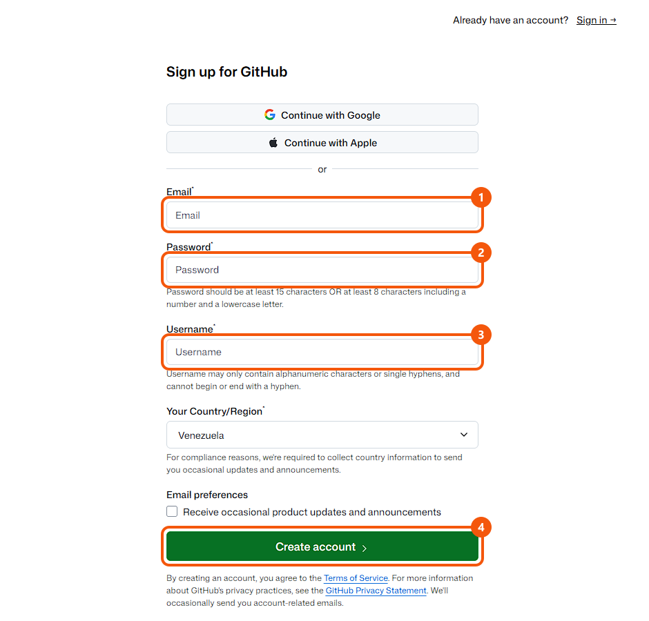

*Correo (1), contraseña (2) y usuario (3); luego, **Create account** (4). El registro es gratuito.*

3. Activa la **verificación en dos pasos** en **Settings → Password and authentication**. GitHub la exige para contribuir, y protege tu cuenta.


*Elige «Authenticator app» y usa una app como Google Authenticator o Authy. Cuando está activa, aparece «Enabled».*

## Los conceptos que vas a usar

### Repositorio

Un **repositorio** (o *repo*) es un proyecto guardado con Git: sus archivos más todo su historial. Esta web es un repositorio.

### Ramas

Una **rama** es una línea de trabajo aparte. Creas una rama para tu cambio, trabajas en ella y, cuando está lista, se une a la principal. Así la versión publicada nunca se rompe mientras trabajas.


*En esta web la rama principal se llama `master`. En otros proyectos se llama `main`.*

Los comandos de ramas que necesitas:

```sh
git branch                      # lista las ramas y marca en la que estás
git switch -c nombre-de-rama    # crea una rama nueva y te cambia a ella
git switch master               # vuelve a una rama que ya existe
```

> En tutoriales viejos verás `git checkout` en lugar de `git switch`. Hacen lo mismo; `switch` es la forma moderna y más clara.

### Fork

No puedes escribir directamente en un proyecto ajeno. Por eso haces un **fork**: tu propia copia del repositorio en GitHub. Trabajas en tu copia y, al terminar, pides que tus cambios pasen al original.

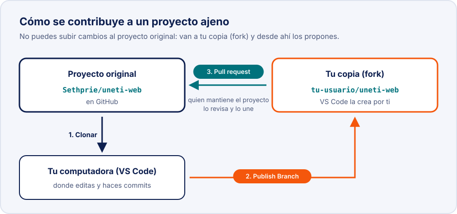

*Los cuatro pasos de cualquier contribución en GitHub.*

### Pull request

Un **pull request** (PR) es la propuesta que haces para que tus cambios entren en el proyecto original. Quien mantiene el proyecto lo revisa, puede pedirte ajustes y, si está bien, lo acepta.

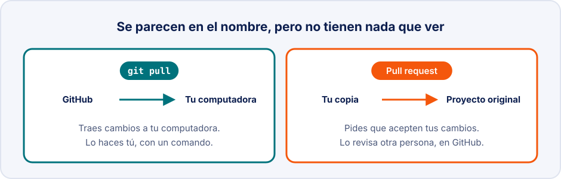

*La confusión más común al empezar.*

## Práctica: tu primera contribución

Vas a proponer un cambio a una guía de esta web. Elige algo pequeño: corregir una errata o añadir un dato útil.

### Ruta rápida (desde el navegador)

Sin instalar nada. Ideal para cambios de texto.

1. Entra en la [carpeta de guías del repositorio](https://github.com/Sethprie/uneti-web/tree/master/src/content/guias) y abre la guía que quieres mejorar.

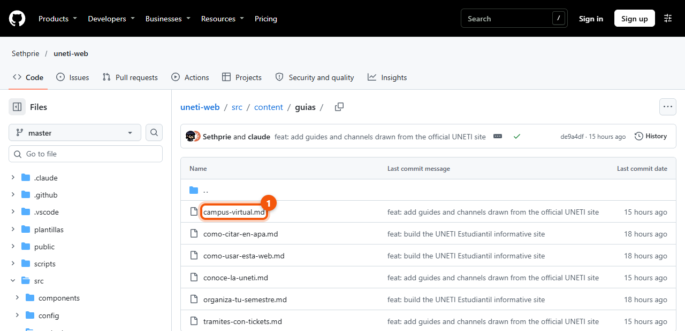

*Cada archivo `.md` es una guía de la web.*

2. Pulsa el **lápiz** para editar.

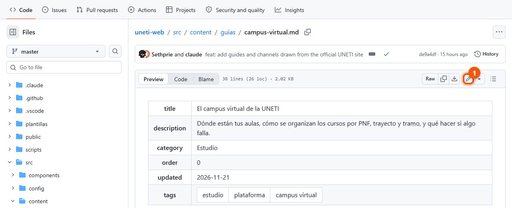

*Si no has iniciado sesión, GitHub te lo pedirá.*

3. GitHub te avisará de que necesitas un fork. Pulsa **Fork this repository**: lo crea por ti.

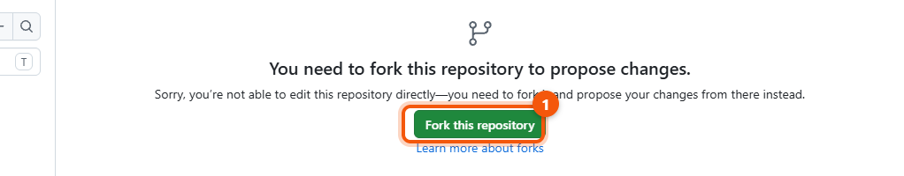

*Solo pasa la primera vez.*

4. Haz tu cambio en el editor. En la pestaña **Preview** ves cómo queda.

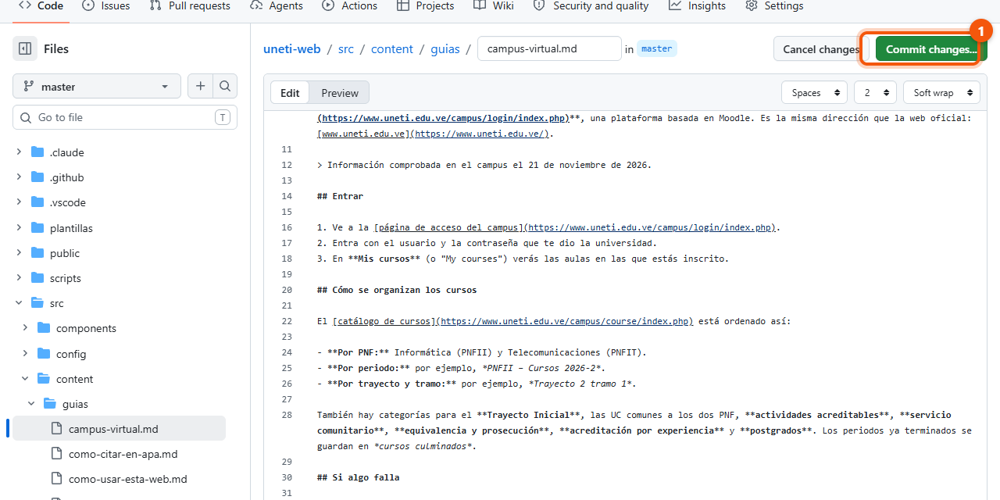

*El texto está en Markdown: `**negrita**`, `## Título`, `- lista`.*

5. Pulsa **Commit changes...**, escribe un mensaje que explique el cambio y pulsa **Propose changes**. Si ves la opción de elegir rama, marca **Create a new branch**: nunca escribas directo en `master`.

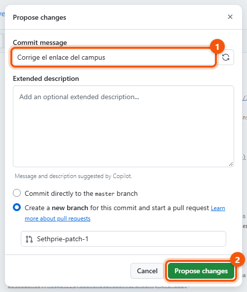

*Un buen mensaje dice qué cambia: «Corrige el enlace del campus».*

6. En la página siguiente, revisa el título y pulsa **Create pull request**.


*En la descripción puedes explicar por qué propones el cambio.*

Listo: tu propuesta queda abierta para revisión. Salta a [Después del pull request](#después-del-pull-request).

### Ruta completa (con Git)

**1. Haz un fork.** En el [repositorio](https://github.com/Sethprie/uneti-web), pulsa **Fork** (1) y confirma con **Create fork**.

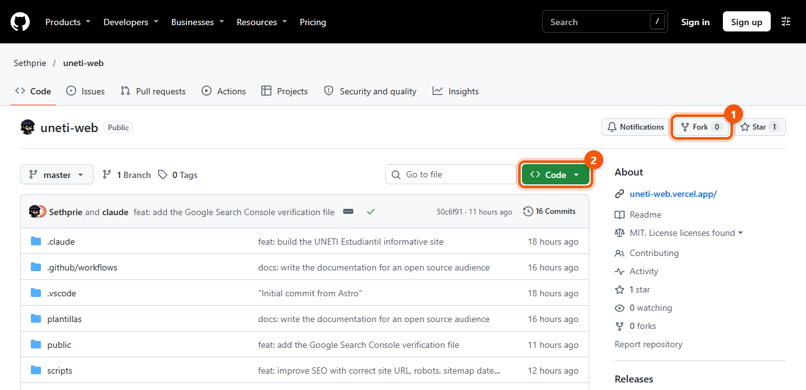

*El botón **Code** (2) lo usarás en el paso siguiente, ya en tu copia.*

**2. Copia la dirección de tu fork.** En tu copia (`github.com/tu-usuario/uneti-web`), pulsa **Code** y copia la dirección HTTPS.

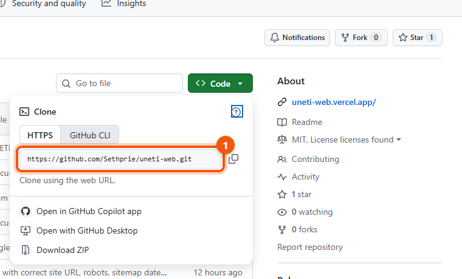

*Asegúrate de que la dirección tenga tu usuario, no `Sethprie`.*

**3. Clona y crea tu rama.** Abre Git Bash y escribe, con tu usuario:

```sh
git clone https://github.com/tu-usuario/uneti-web.git
cd uneti-web
git switch -c mi-primer-cambio
```

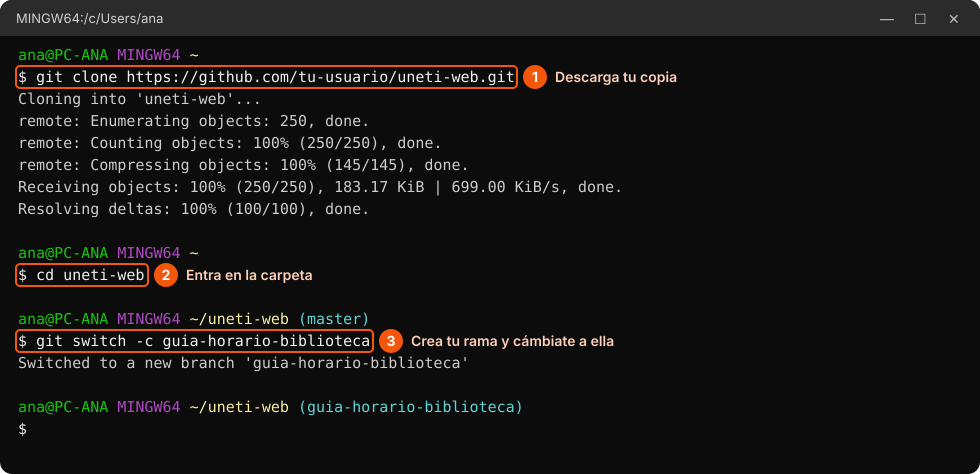

*Entre paréntesis, la terminal te recuerda en qué rama estás.*

**4. Haz tu cambio.** Abre el archivo con tu editor, cámbialo y guárdalo.

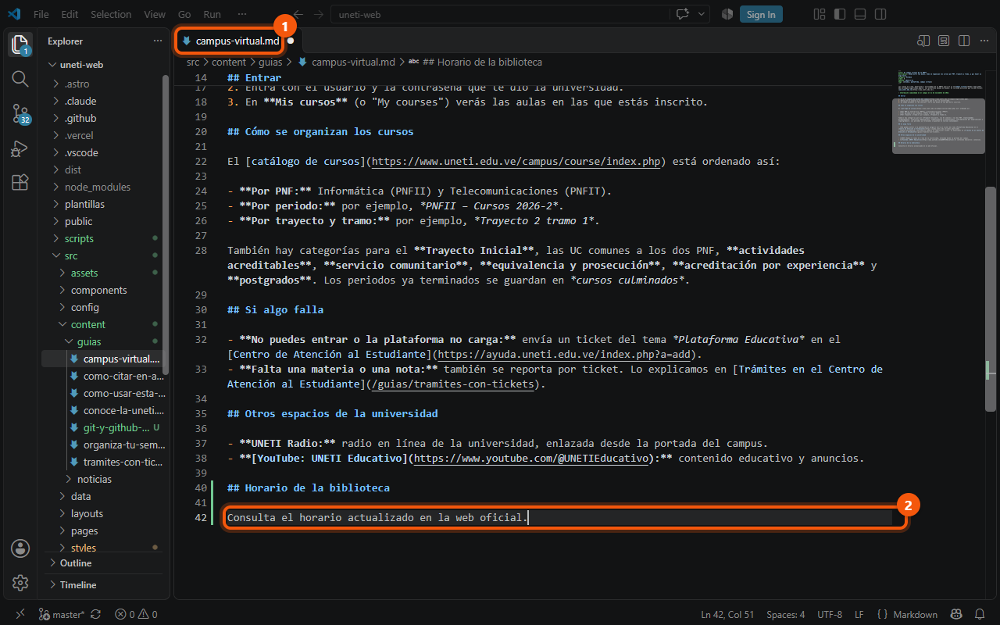

*El punto en la pestaña (1) indica que no has guardado. La barra verde junto a las líneas (2) marca lo que es nuevo respecto al último commit.*

**5. Revisa qué cambió** con `git status`. Es el comando que más usarás: siempre te dice dónde estás y qué falta.


*En rojo, lo que cambiaste y aún no está preparado.*

**6. Prepara y guarda el commit:**

```sh
git add src/content/guias/campus-virtual.md
git commit -m "Añade horario de la biblioteca a la guía del campus"
```

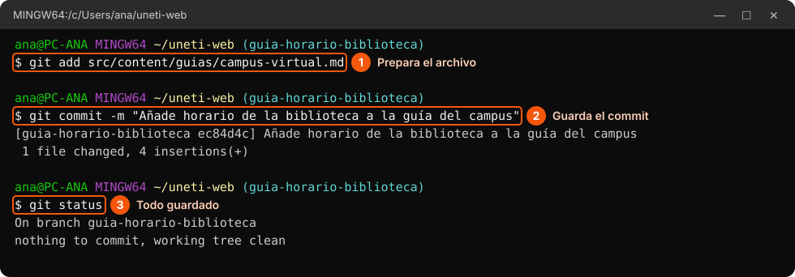

*«working tree clean» significa que todo está guardado en el historial.*

**7. Sube tu rama** a tu fork:

```sh
git push -u origin mi-primer-cambio
```

La primera vez, Git abrirá una ventana para que inicies sesión en GitHub desde el navegador. Solo pasa una vez.

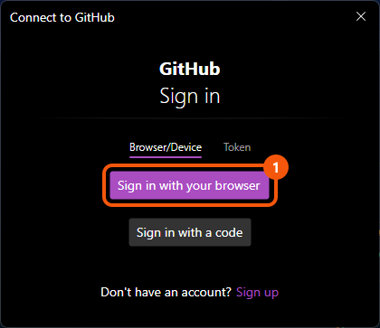

*Pulsa «Sign in with your browser» y autoriza el acceso.*

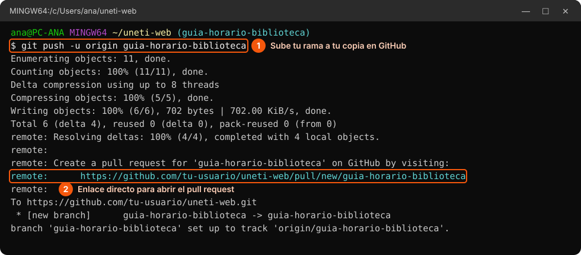

*Git te da el enlace directo para abrir el pull request.*

**8. Abre el pull request.** Entra en tu fork en GitHub: verás un aviso con el botón **Compare & pull request**. Púlsalo, revisa el título y pulsa **Create pull request**.

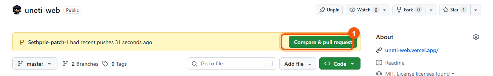

*También puedes usar el enlace que te dio `git push`.*

## Después del pull request


*Recibirás un aviso por correo cuando alguien comente.*

- Si te piden ajustes, haz los cambios **en la misma rama**, `commit` y `push` otra vez. El pull request se actualiza solo.
- Cuando lo aceptan, tu cambio llega a `master` y se publica en la web.
- Para tu siguiente contribución, actualiza tu copia antes de empezar: en tu fork en GitHub, pulsa **Sync fork**; luego, en tu carpeta, `git switch master` y `git pull`.

## Si algo sale mal

- **No sabes dónde estás:** escribe `git status`. Te dice la rama, qué cambió y, muchas veces, qué comando usar.
- **`fatal: not a git repository`:** no estás dentro de la carpeta del proyecto. Entra con `cd uneti-web`.
- **`Permission denied` al hacer push:** estás intentando subir al original en vez de a tu fork. Revisa que clonaste la dirección con tu usuario.
- **Hiciste cambios en `master` sin querer:** crea la rama ahora con `git switch -c nombre`. Tus cambios se van contigo a la rama nueva.

## Qué no cubre esta guía

Lo que viste es suficiente para contribuir. Cuando quieras avanzar, estos son los siguientes temas:

- **Conflictos:** cuando dos personas cambian la misma línea y Git no sabe con cuál quedarse.
- **`git stash`:** guardar cambios a medias sin hacer commit.
- **`git rebase`:** reordenar o limpiar el historial de una rama.
- **Llaves SSH:** otra forma de conectarte a GitHub, sin iniciar sesión.
- **GitHub Actions:** tareas automáticas. Esta web las usa para publicarse.

### Para seguir aprendiendo

- **[Pro Git](https://git-scm.com/book/es/v2):** el libro oficial de Git, gratuito y en español.
- **[Learn Git Branching](https://learngitbranching.js.org/?locale=es_ES):** ejercicios interactivos para entender las ramas, en español.
- **[GitHub Skills](https://skills.github.com/):** cursos prácticos dentro del propio GitHub.

¿Te trabaste en algún paso? Pregunta en la comunidad: los enlaces están en la [página de inicio](/#comunidad).
